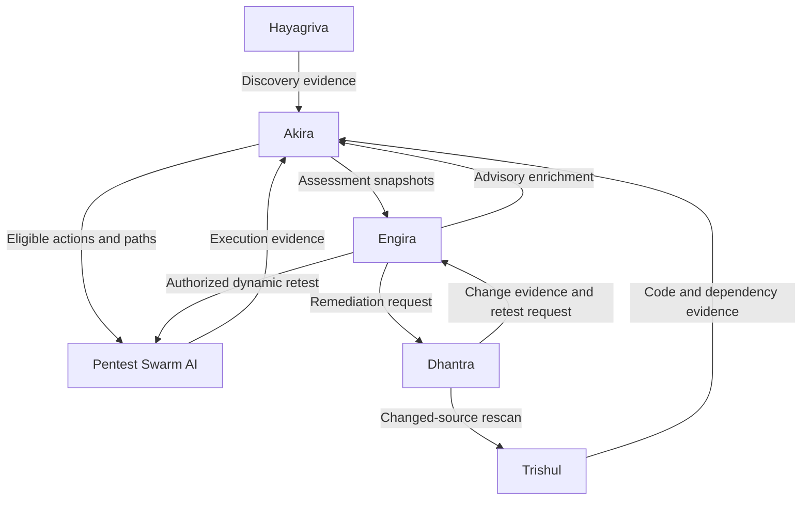

# Engira

**Vulnerability intelligence, reporting & case management for the Armur suite — in Go.**

> **Status: scaffold.** This repository is initialized; everything below is
> **planned**, not yet built. No feature is claimed as working until its own
> package/docs say so. Written in **Go**.
>
> **Naming note:** this Engira is the **intelligence/reporting** product
> (formerly "Ahobal"). An older "Engira" referred to *recon* — that recon role
> now lives in **Hayagriva**. Historical source/evidence strings may retain old
> names with explicit migration provenance; the string "Engira" alone does not
> identify an old export's role.

Engira is the suite's **intelligence and reporting** layer. It supplies
versioned advisory applicability, standards/scoring, and mapping; it imports
immutable assessment results, manages review and cases, drives retesting
workflows, and assists with disclosure / CVE-request. It binds enrichment to
evidence and displays attributable results.

## Role in the Armur suite



Engira supplies advisory/scoring/mapping to Akira, receives assessment
snapshots back, manages the human-in-the-loop (review/cases/approvals), creates
**remediation requests** for Dhantra, and can authorize scoped dynamic retests
(via Swarm).

## What it will do (planned)

- **Vulnerability intelligence** — a versioned advisory store; applicability
  matching (does this advisory affect this component/version?).
- **Standards & scoring** — CVSS and related scoring, CWE/OWASP/ATT&CK mapping,
  as versioned services (so results are reproducible and attributable).
- **Reporting** — exec / technical / compliance / SARIF report generation from
  immutable assessment snapshots, with provenance and ROI framing.
- **Assessment review & cases** — import immutable results; manage review,
  triage, approval, and case lifecycle.
- **Retesting workflows** — request authorized dynamic retests through Swarm;
  track open → verified-closed lifecycle.
- **Disclosure / CVE assistance** — structured advisory drafting and
  CVE-request support (assistive, human-approved).

## Design principles

- **Immutable inputs, versioned outputs.** Assessment results are imported
  immutably; advisory/scoring results carry a version so a score is reproducible.
- **Attribution over assertion.** A report, a merged PR, or a changed scanner
  result is **not** by itself proof a security property was repaired — Engira
  preserves the full chain and its limits.
- **A CVSS score is not an authorization** to change anything; remediation
  requests carry explicit scope, policy, and approval.
- **Standalone first.** Imports a versioned request or a supported SARIF subset
  with explicit source attribution; it must not require every suite service running.

## Install (planned)

```bash
go install github.com/Armur-Ai/Engira/cmd/engira@latest
```

Module path: `github.com/Armur-Ai/Engira`.

## Status & roadmap

Fresh scaffold. See [ROADMAP.md](./ROADMAP.md).

## License

See `LICENSE` (to be added).
